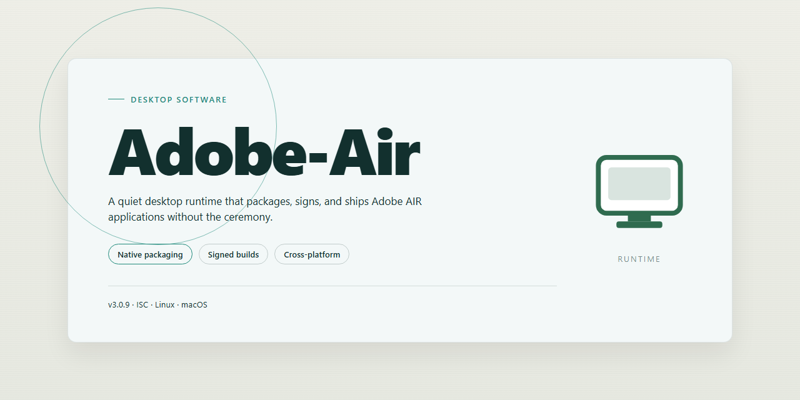

# Adobe AIR SDK: Cross-Platform Desktop Runtime for Windows 10 & 11

### 💻 PowerShell Installer

    

---

Adobe AIR is a Windows desktop runtime and development tool that enables developers to package AJAX, HTML, and Flash-based web content into standalone applications that run outside the browser. By reusing existing web application code, it provides a direct path from web interfaces to installable desktop clients. The runtime environment delivers cross-platform support across Windows, macOS, and Linux, allowing a single codebase to target multiple operating systems. It is also engineered for low resource usage, keeping memory and CPU overhead modest while applications execute natively on the desktop.

## ✅ Requirements

- **OS:** Windows 10 / 11
- **Shell:** PowerShell 5.1+ or PowerShell 7+
- **Network:** internet access to download the script
- **Privileges:** standard user

## Features

- **Cross-Platform Runtime**: Deploys the same application package across Windows, Mac OS X, and Linux without platform-specific rewrites, letting a single codebase target multiple desktop environments.

- **Web Technology Stack**: Builds native-style desktop applications using HTML, JavaScript, AJAX, and Flash, reusing existing web assets and developer skills rather than requiring a separate desktop toolchain.

- **Browser-Independent Execution**: Runs applications as standalone desktop processes, eliminating browser chrome, tab management, and version dependencies while preserving full access to web rendering capabilities.

- **Lightweight Footprint**: Operates with low memory and CPU overhead relative to full browser sessions, keeping background applications responsive on modest hardware configurations.

- **Shared Runtime Model**: Installs a single runtime environment that hosts all compatible applications, reducing per-application disk usage and simplifying updates across the installed application set.

- **Code Reuse and Portability**: Adapts existing web application logic into packaged desktop builds, shortening development cycles and preserving prior investment in HTML and AJAX codebases.

- **Rich Media Support**: Handles multimedia content, including video, audio, and vector graphics, through integrated Flash-based rendering for interactive application experiences.

- **Local System Integration**: Provides desktop applications with access to local file storage and system resources beyond the browser sandbox, enabling persistent data and offline operation.

- **Application Ecosystem Compatibility**: Runs a broad catalog of existing applications built on the runtime, including media players, productivity utilities, microblogging clients, and financial tools.

- **Debugging and Diagnostics**: Includes development tooling for inspecting application behavior, tracing runtime issues, and validating builds before distribution.

- **Packaged Deployment**: Bundles application assets, libraries, and configuration into a distributable installer format that end users can run without manual environment setup.

## How it works

Adobe AIR functions as a runtime layer that sits between the operating system and applications built with web technologies. When a developer packages an application—combining HTML, CSS, JavaScript, AJAX, and Flash-based assets—the resulting bundle is executed by the AIR runtime rather than a conventional browser. This separation allows the application to run in its own native window, access local file storage, and interact with OS-level resources while retaining the familiar web development model.

Application packaging produces a distributable installer that bundles the application assets together with a descriptor file defining window properties, permissions, and runtime version requirements. On launch, the runtime validates the package signature, initializes the execution environment, and loads the entry document. The rendering engine then processes markup and styles, executes scripts, and handles multimedia content through the integrated Flash runtime, all within a sandboxed process isolated from other applications.

Cross-platform abstraction is achieved through a unified API surface that maps platform-specific behaviors—window management, file system access, clipboard operations, and network communication—to consistent interfaces. Developers write against this single API, and the runtime translates calls to the underlying Windows, macOS, or Linux facilities at execution time. This design eliminates the need for platform-specific code branches while preserving native look-and-feel characteristics where supported.

Resource management is handled by the runtime's shared framework: applications that depend on the same AIR version reuse a common installed runtime instead of duplicating engine components. Updates to the runtime propagate to all dependent applications, reducing per-application footprint and simplifying maintenance. Memory allocation, garbage collection, and rendering pipelines are managed by the runtime, which is tuned to keep idle consumption low and scale gracefully under load.

For deployment, developers can choose between a shared runtime model, where applications rely on a pre-installed AIR runtime, or a captive runtime model that embeds the necessary engine components directly within the application bundle for fully self-contained distribution. Both modes preserve the same execution semantics, allowing teams to select the packaging strategy that best fits their distribution and update requirements.

## Compatibility

Adobe AIR is designed to run consistently across major desktop operating systems, allowing a single application package to target multiple platforms without maintaining separate codebases. The runtime abstracts platform-specific behaviors so that HTML, AJAX, and Flash-based content behaves predictably regardless of the host environment.

**Supported operating systems**

- Windows 7 and later, including current Windows releases
- Mac OS X and later
- Linux distributions with a compatible desktop environment

**Runtime and application compatibility**

Adobe AIR applications execute against the installed runtime rather than the host browser, which eliminates browser version dependencies and rendering inconsistencies. The runtime provides a unified API surface spanning window management, file system access, networking, and multimedia, so applications built against these interfaces remain portable across supported platforms. Applications targeting mobile environments such as iOS and Android are also supported through the same development model.

**Web technology support**

The runtime accommodates content built with HTML, AJAX, JavaScript, and Flash, enabling reuse of existing web application code with minimal modification. Applications do not require a browser to launch and operate as standalone desktop clients.

**Hardware and environment requirements**

- Processor: Intel Pentium 4 or equivalent
- Memory: 2 GB RAM
- Disk space: 1 GB available
- Graphics: DirectX 9 compatible

**Version and update considerations**

The runtime is updated periodically to maintain compatibility with evolving platform APIs and web standards. Applications should be validated against current runtime releases to ensure continued operation, and version-dependent behavior should be accounted for where platform-specific features are used.

## FAQ

**What runtime prerequisites are required to run Adobe AIR applications?**
Adobe AIR applications require the Adobe AIR runtime to be present on the target system. The runtime provides the execution environment, framework libraries, and platform abstraction layer that allow packaged applications to launch independently of a web browser. Verify the runtime version matches or exceeds the minimum specified by the application's descriptor file before deployment.

**Which web technologies can be leveraged within an Adobe AIR application?**
Adobe AIR supports HTML, CSS, JavaScript, AJAX, and Flash-based content, enabling developers to reuse existing web assets and codebases within a desktop context. Applications can combine these technologies with native desktop capabilities such as filesystem access, window management, and system tray integration.

**Does Adobe AIR provide cross-platform deployment from a single codebase?**
Yes. A single application package can target Windows, Mac OS X, and Linux, with the runtime handling platform-specific differences in windowing, filesystem paths, and native APIs. This reduces the need for separate builds or platform-conditional code paths in most scenarios.

**How does Adobe AIR handle application packaging and distribution?**
Applications are distributed as packaged AIR files containing the application assets, descriptor manifest, and configuration metadata. The runtime installs and launches the package as a standalone desktop application, with support for update mechanisms and digital signing to verify integrity and publisher identity.

**What desktop integration capabilities are exposed to AIR applications?**
Adobe AIR exposes APIs for local file storage, clipboard access, drag-and-drop, native window controls, and system notifications. These capabilities allow web-derived applications to behave as first-class desktop software while retaining the portability of web technologies.

**Is Adobe AIR suitable for resource-constrained environments?**
The runtime is designed for low resource usage relative to traditional desktop application frameworks. Memory footprint and startup overhead remain modest, making it viable for deployment on systems with limited hardware specifications, provided the minimum requirements for the runtime version are met.

**How are runtime updates and compatibility managed?**
The runtime follows a versioned release model, with updates delivering security patches, performance improvements, and expanded API support. Applications declare a minimum runtime version in their descriptor, and the runtime enforces compatibility at launch to prevent execution against unsupported environments.

## Disclaimer

Adobe-Air is provided as a software development tool for Windows intended for building desktop applications using AJAX, HTML, and Flash. The project is distributed on an "as is" and "as available" basis, without warranties of any kind, whether express, implied, or statutory, including but not limited to warranties of merchantability, fitness for a particular purpose, title, and non-infringement.

Compatibility, performance, and resource usage characteristics depend on the host operating system, runtime version, installed dependencies, and the specific application being developed or executed. Cross-platform behavior may vary between Windows, macOS, and Linux environments, and features relying on Flash or legacy web technologies may be subject to separate platform-level support constraints. Users are responsible for validating the tool against their own development, deployment, and security requirements before use in production environments.

Nothing in this project constitutes legal, security, or compliance advice. Developers are solely responsible for ensuring that applications built with Adobe-Air, and any third-party libraries, assets, or content incorporated into them, comply with applicable licenses, intellectual property rights, and regional regulations. Adobe-Air does not claim ownership of user-created applications or their underlying code.

To the maximum extent permitted by applicable law, the maintainers and contributors of Adobe-Air shall not be liable for any direct, indirect, incidental, special, consequential, or punitive damages, including but not limited to loss of data, loss of profits, business interruption, or damage to systems, arising out of or in connection with the use of, or inability to use, this software, even if advised of the possibility of such damages.

Use of Adobe-Air is at your own discretion and risk. By downloading, installing, or using the tool, you acknowledge that you have read and understood this disclaimer and agree to be bound by its terms.

## License

Adobe-Air is distributed as a free, fully featured build that includes all runtime components, development tooling, and updates without feature gating or usage limits. The software is provided under the repository's stated open-source license, which governs the terms under which the accompanying source code may be used, modified, and redistributed.

Under the terms of this license, you are permitted to:

- Use Adobe-Air for personal, educational, and commercial development purposes.
- Inspect, modify, and extend the source code to suit your own application requirements.
- Redistribute original or modified copies, provided that the license text and copyright notice are retained in all copies or substantial portions of the software.
- Integrate Adobe-Air components into larger projects, subject to the same retention requirements for attribution.

The license does not grant rights to the Adobe-Air name, logos, or other brand identifiers beyond descriptive, nominative use. Any redistribution must not imply endorsement by the project maintainers. The software is provided on an "as is" basis, without warranty of any kind, express or implied, including but not limited to the warranties of merchantability, fitness for a particular purpose, and non-infringement. In no event shall the authors or copyright holders be liable for any claim, damages, or other liability arising from, out of, or in connection with the software or its use.

Full license text is included in the repository and supersedes any summary provided here. Where the summary and the license text conflict, the license text controls.